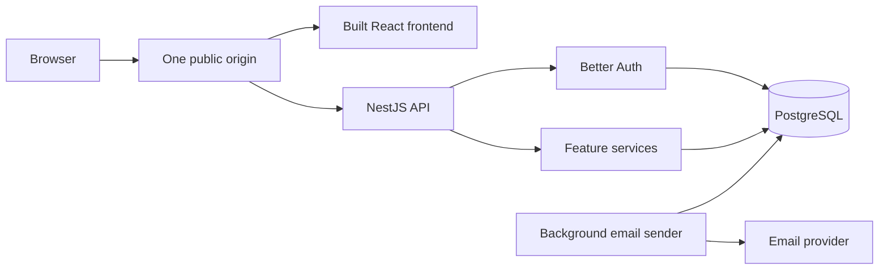

# System Architecture

## 1. Purpose and Current State

This document translates [PRD.md](PRD.md) into the agreed technical direction for V1: a public portfolio demo for one organization's free, in-person workshops and seminars.

The repository currently contains a NestJS starter and a Prisma configuration with no business models. The layout and components below describe the target architecture, not completed implementation.

Keep the existing NestJS 11 and Prisma 7 major versions. Select compatible integrations during implementation; writing this document does not install dependencies, move application files, or change the schema.

## 2. System Structure

Use a modular monolith: one NestJS application organized by feature, one React frontend, and one PostgreSQL database. The NestJS process also runs the background email sender.

### Repository Layout

| Location | Responsibility |
| --- | --- |
| `backend/` | Existing NestJS application, backend tests, Prisma schema and migrations, and backend package/configuration files. |
| `frontend/` | React, TypeScript, Vite, frontend routes, feature components, and its package/configuration files. |
| Repository root | Product and engineering documents, repository-wide agent instructions, and Git configuration. |

Move the current backend into `backend/` when implementing the layout. Adjust configuration, generated-client paths, ignore rules, and documented commands as part of that move. Until then, the existing root-level commands and schema location remain current.

### Technology Responsibilities

| Technology | Purpose |
| --- | --- |
| React + TypeScript + Vite | Build the browser application. |
| React Router | Client-side navigation between public, attendee, and admin pages. |
| TanStack Query + native `fetch` | Fetch and synchronize application server data. |
| NestJS | HTTP API, authorization, feature services, and background delivery. |
| Zod | Validate application API inputs through a small NestJS validation pipe. |
| Better Auth | Email/password and Google sign-in, sessions, verification, recovery, and account linking. |
| Prisma + PostgreSQL | Database access, transactional writes, and persistent state. |

Use the existing controller -> service -> Prisma convention. Additional abstraction layers require a concrete need in an implemented feature.

### Runtime and Dependency Choices

Use Node.js 24 for development and deployment. Retain NestJS 11, Prisma 7, the Express adapter, and the installed TypeScript/Jest tooling. Installed versions belong in `backend/package.json` and its lockfile.

The following selected versions are approved for installation in their owning tasks:

| Package | Selected version | Owning task |
| --- | --- | --- |
| `@thallesp/nestjs-better-auth` | 2.8.0 | P1-07 |
| `zod` (direct dependency) | 4.6.7 | P1-12 |
| `auth` (development dependency) | 1.7.13 | P1-04 |
| `@nestjs/serve-static` | 5.0.5 | P3-10 |
| `react`, `react-dom` | 19.3.1 each | P1-03 |
| `react-router` | 8.5.0 | P1-03 |
| `@tanstack/react-query` | 5.105.0 | P1-03 |
| `vite`, `@vitejs/plugin-react` (development dependencies) | 8.3.5 / 6.1.2 | P1-03 |
| `@types/react`, `@types/react-dom` (development dependencies) | 19.3.0 each | P1-03 |

Keep these choices in the corresponding manifests and lockfiles once installed. Review replacements before changing selected versions.

- Use backend ESM with `"type": "module"`, `module: nodenext`, `moduleResolution: nodenext`, and `target: ES2023`, following the [Prisma 7 NestJS guide](https://www.prisma.io/docs/guides/v7/frameworks/nestjs). Relative backend imports use `.js` extensions. The frontend uses Vite's ESM/bundler configuration and React Router's declarative mode.
- Keep `backend/prisma7.config.ts`; the installed Prisma configuration loader discovers it. Retain `prisma-client`, set `moduleFormat = "esm"`, and generate into `../src/generated/prisma`. The application build includes `src` with that directory as its root, preserving the `dist/main.js` entry point. Business models and migrations retain their separate review.
- `backend/src/prisma.service.ts` owns the application Prisma client and PostgreSQL adapter. `PrismaModule` registers and exports it for feature-module injection; import the module instead of registering another PrismaService provider. The service loads backend environment configuration, rejects a missing `DATABASE_URL`, and disconnects on module destruction. Bootstrap enables shutdown hooks. Connections remain lazy until a database operation; configuring the provider does not verify database connectivity. The standalone `backend/lib/` examples are unmounted drafts outside the application build; Better Auth's runtime integration must receive the shared injected service rather than create a second client.
- Keep Jest and ts-jest, configured for ESM transforms and `.ts` module handling. Test scripts invoke Node with `--experimental-vm-modules`; Jest maps relative `.js` imports to TypeScript sources. The starter HTTP test overrides PrismaService so it does not require database credentials or make database requests.
- Use the pinned local `auth` CLI from `backend/` with explicit configuration and output paths: `npm exec -- auth generate --config ./src/auth/auth.ts --adapter prisma --dialect postgresql --output ./prisma/schema.prisma`. Review the generated authentication models against `DATABASE.md` before preparing Prisma migrations.
- Integrate Better Auth under `/api/auth` through the community-maintained NestJS wrapper. Reuse the shared Prisma client with `provider: "postgresql"`; the existing `better-auth/adapters/prisma` export supplies the adapter. Use database sessions and the `better-auth/react` client.
- `AppAuthModule` uses the wrapper's async registration to inject the shared PrismaService. Email/password access is enabled; session cookie caching is disabled so revocation is checked against PostgreSQL. Public registration explicitly rejects supplied roles, and profile updates retain Better Auth's `input: false` protection. `GET /api/session` returns only the authenticated user's public fields. The frontend uses one `better-auth/react` client through Vite's same-origin proxy, account forms, and session-aware navigation; it does not store tokens in browser storage.
- `BETTER_AUTH_URL` and `FRONTEND_URL` select exact trusted origins, with local defaults `http://localhost:3000` and `http://localhost:5173`; both are required explicitly in production. Keep Better Auth's origin and CSRF protections enabled explicitly, including in tests. `ApplicationOriginGuard` also checks trusted Origin/Referer on cookie-authenticated application mutations; safe HTTP methods remain exempt. Keep the authentication wrapper's global session guard enabled and annotate public routes individually.
- Disable NestJS body parsing at bootstrap and let the integration restore application JSON/form parsers. Keep its global authentication guard and explicitly allow anonymous routes; verification and application-role guards remain feature responsibilities. Check module loading and JSON request parsing during integration.
- Make `User.role` server-owned through an additional field with default `ATTENDEE` and `input: false`. Use private application provisioning rather than adding the Better Auth admin plugin. Preserve matching verified-email linking, `requireLocalEmailVerified: true`, and disabled different-email linking without a trusted-provider bypass.
- Supply environment-specific base URLs, trusted origins, Google credentials, and email callbacks in their owning tasks. Preserve origin protection and keep verification/recovery mail outside the business-notification queue.

## 3. Backend Modules and Boundaries

| Module | Owns |
| --- | --- |
| Authentication | Better Auth configuration and integration, session access, verified-email checks, and role guards. |
| Events | Public discovery, publishing, event details, capacity and registration deadlines, rescheduling, and event cancellation. |
| Reservations | Booking, attendee/admin cancellation, rebooking, ownership checks, booking references, and reservation history. |
| Notifications | Pending booking/event messages, delivery processing, retries, and the admin failed-email list. |
| Database access | One shared Prisma client and its application lifecycle. |

The approved eight-model design, ERD, field definitions, native constraints, and history rules are in [DATABASE.md](DATABASE.md). It has not yet been implemented in Prisma.

Controllers translate HTTP input/output and delegate to services. Services own business decisions and database transactions. Feature modules expose services when another feature needs their business operations; controllers do not call other controllers.

A business operation has one transaction owner. Any participating service receives the same transaction client for its database work; it must not start an independent transaction for writes that need to commit together.

Better Auth owns its authentication handlers, password handling, and token lifecycle. Its handlers are a separate integration boundary from application controllers and their Zod validation.

## 4. HTTP and Frontend Data Flow

### Application API

Expose JSON application APIs under `/api`, with Better Auth owning `/api/auth/*`. Public discovery, attendee reservations, and admin operations share the backend but have different access requirements.

An application request follows:

**Route -> authentication/authorization -> Zod validation -> controller -> service -> Prisma -> response.**

- Public discovery endpoints allow anonymous access.
- Attendee operations check the authenticated identity and reservation ownership on the server.
- Booking checks verified-email eligibility on the server.
- Admin operations check the server-controlled admin role.
- Zod validates application request bodies, query parameters, and path inputs before business logic runs.
- Services raise expected application exceptions. Exception filters return appropriate HTTP statuses and structured, useful errors with validation details where relevant.
- Unexpected errors are logged internally and returned as safe server errors, without raw Prisma errors or stack traces.

Exact endpoint inventories and payload schemas will be defined with their features. The frontend must not receive database records indiscriminately; responses expose the data needed by the corresponding page or operation.

### Frontend

- React Router handles public discovery pages, account flows, My reservations, and private admin pages.
- TanStack Query owns application server data such as event lists, event details, reservations, and failed-email records.
- Native `fetch` makes application HTTP requests. Better Auth's client handles its own authentication API contract and session state.
- A successful booking, cancellation, or admin mutation refreshes the affected queries.
- Local React state handles form inputs and temporary UI state. Search and date filters belong in URL query parameters so filtered views can be revisited.
- Pages provide loading, empty, success, and useful failure states.
- Displayed availability helps attendees browse; the backend transaction decides whether a reservation succeeds.

Client-side route protection is a navigation convenience. Backend authorization remains required for every protected operation.

## 5. Authentication and Authorization

Use Better Auth with PostgreSQL-backed sessions. The browser sends a session cookie to the same-origin API; Better Auth validates the session and establishes the user identity.

- Use secure, HTTP-only cookies in production over HTTPS.
- Configure the public base URL, trusted origins, and Google callback URLs for the actual environment.
- Retain Better Auth's origin protections and protect cookie-authenticated application mutations against CSRF.
- Validate the session and current permissions on the backend. Admin roles and attendee identities are not accepted from request bodies or Google profile claims.
- Public registration grants attendee access only. Admin access remains privately controlled.
- Admins also have attendee capabilities. Their personal bookings use the same eligibility and reservation rules; protected management operations remain separate and record their actor.
- Email/password attendees verify their email before booking. A trusted Google-verified address needs no extra verification email.

### Account Linking

Automatically link Google to an existing account only when the email addresses match and both identities have verified email ownership. Keep the existing user identity, reservations, and permissions.

An unverified address or a different email does not qualify for automatic linking. Do not enable forced provider trust that bypasses email verification. Check the chosen Better Auth version's configuration and hooks to enforce both verification conditions; do not assume every default implements this project policy.

Linking does not automatically create a password. Better Auth continues to own password setup/recovery behavior. Test that switching between linked sign-in methods reaches the same attendee and booking history.

## 6. Reservation Consistency and Time Rules

### Transaction Boundary

Use a short Prisma interactive transaction with PostgreSQL row locking for writes that affect an event's booking eligibility or reservations. Use `READ COMMITTED` isolation and acquire the event row with `SELECT ... FOR UPDATE` before checking availability and making related writes.

After acquiring the event lock:

1. Read the current event state and check the registration deadline and start time.
2. Check reservation eligibility, duplicate active reservations, and the current confirmed count.
3. Apply the business change.
4. Record its pending booking/event notifications using the same transaction client.
5. Commit before contacting the email provider.

All booking, cancellation, rebooking, capacity, registration-deadline, schedule, and event-cancellation writes follow the same event-lock protocol. This serializes conflicting writes to one event while ordinary browsing and operations on other events can continue.

Recheck time-dependent conditions after waiting for the lock. Keep database transactions short and exclude email-provider calls. If a transactional write fails, the business change and its pending notifications roll back together.

Database constraints must also enforce appropriate uniqueness, including booking references and at most one active reservation per attendee/event. [DATABASE.md](DATABASE.md) specifies a native PostgreSQL partial unique index for confirmed reservations, preserving cancelled history and rebooking. A normal availability read followed by an unrelated insert does not satisfy the capacity requirement.

### Cancellation and Rebooking

Services enforce the PRD's more-than-24-hours self-service cancellation rule, admin handling of late requests, and exception for attendees affected by date or venue changes.

Self-service rebooking is allowed when capacity remains and registration is open. Create a new reservation and booking reference; retain the earlier cancelled reservation in history. The database design must support this history while preventing duplicate active reservations.

`Event.scheduleRevision`, immutable `EventChange` records, and `Reservation.bookedRevision` distinguish affected attendees from people who book or rebook after a change. Require an admin reason and store previous/new schedule and venue details with the actor and time for significant changes. Description, capacity, and deadline edits do not advance the schedule revision.

Lock significant schedule/venue changes at the current start time. Event cancellation remains available before the scheduled end, including during the session; preserve the original schedule and record the cancellation time, actor, and reason. Cancel the remaining confirmed reservations and enqueue their notices in the same transaction. Admin reservation cancellations also require a recorded reason.

Use one organizer contact email from application configuration for all workshops and late-cancellation instructions. This contact address is independent of the individual admin login accounts.

### Dates and Language

- Store timestamps in UTC and compare deadlines as instants on the backend.
- Interpret event input and date filters in `Asia/Jakarta`.
- Display event times and deadlines explicitly as WIB in the interface and emails.
- Do not let the browser's local timezone silently change the intended WIB date or time.
- Use English consistently for interface copy and essential emails.
- V1 has one fixed organization timezone and no timezone settings screen.

## 7. Notifications and Delivery Recovery

For booking confirmations, reservation cancellations, event cancellations, and significant event changes, persist pending messages alongside the business change. This is a transactional outbox: PostgreSQL stores work that remains available if the application restarts before sending.

The sender runs in the NestJS process and:

- Claims eligible work safely in PostgreSQL so overlapping processing cannot intentionally send the same job concurrently.
- Releases the claim transaction before contacting the provider.
- Records provider acceptance or a sanitized failure, and schedules bounded retries with increasing delays for retryable errors.
- Recovers abandoned claims after a restart or interrupted attempt.
- Marks messages unsuccessful after the retry policy is exhausted and exposes them in the private admin failed-email list.
- Allows an admin to request another delivery attempt without repeating the business operation.
- Checks whether a queued message has become obsolete before sending and records it as `SKIPPED` with a reason when appropriate.

Retry processing must not create another reservation or apply an event change again. Manual and automatic retries use the same safe claiming mechanism.

Delivery is at least once, not guaranteed exactly once: a provider can accept a message before the app records success. Use provider-supported idempotency where available and account for ambiguous timeouts. Provider acceptance is not proof of inbox delivery.

The admin list shows useful delivery metadata and sanitized errors, not passwords, recovery tokens, verification links, or provider secrets.

`EmailJob` stores one recipient/reservation context, an optional event-change reference, total/current-cycle attempt counts, claim ownership/expiry, and the latest failure/skip state. Automatic and manual retries share its claim protocol, with stale-owner protection and restart recovery. Its statuses are `PENDING`, `PROCESSING`, `SENT`, `FAILED`, and `SKIPPED`; exact fields and checks are in [DATABASE.md](DATABASE.md).

Skip confirmations for cancelled bookings/events and event-change notices superseded by later revisions or cancellation. Evaluate each job against its specific reservation so rebooking does not suppress a valid cancellation notice for the earlier reference. Still-valid confirmations show current event details. Skipped jobs are not failures offered for manual retry. In-flight messages cannot reliably be recalled.

Better Auth retains ownership of verification and recovery tokens, their expiry, and resend/recovery flows. Its delivery callbacks send through the selected provider using the application's email-delivery boundary. Authentication emails and sensitive links are excluded from the persistent `EmailJob` queue; the business-change/outbox atomicity above applies to booking and event operations.

Resend is the selected delivery provider. `backend/src/email/` exports a shared `EmailService` through `EmailModule`; Better Auth callbacks and the later notification sender will consume it. `send({ to, subject, text })` uses Node's built-in `fetch` with a 10-second timeout covering the request and response-body reading, returns the provider message ID, and reports sanitized failures without logging credentials, contents, or raw provider responses. Configuration is checked when sending, so starting the application does not send email or require provider access. No SDK dependency or automatic retry within `EmailService` is introduced.

Backend environment variables are `RESEND_API_KEY` and `EMAIL_FROM`; `EMAIL_TEST_TO` selects the controlled recipient only for explicit local smoke tests. The `resend.dev` test sender is limited to the account's own inbox. Public-demo sending requires a verified sender domain; domain readiness, budget, and organizer contact configuration remain open under D3.

### Delivery and Retry Policy (D4)

`backend/src/email/delivery-policy.ts` exports the readonly `EMAIL_DELIVERY_POLICY` configuration. These are fixed V1 values in milliseconds, without environment overrides or jitter. P3-05 establishes the policy and shared timeout; P3-06 implements the sender and its policy checks, and P3-07 implements the admin retry operation.

| Setting | Value |
| --- | --- |
| Attempts per retry cycle | 5 total, including the initial attempt |
| Delays after failed attempts 1–4 | 30 seconds, 2 minutes, 10 minutes, 1 hour |
| Worker polling interval | 5 seconds |
| Provider request timeout, including response-body reading | 10 seconds |
| Claim expiry | 60 seconds |
| Resend idempotency window | 24 hours |

Retry delays run from the failed attempt's completion. A retryable response's valid nonnegative `retry-after` value in seconds extends the scheduled delay when longer; a missing or invalid value leaves the scheduled delay unchanged. The fifth unsuccessful attempt ends the cycle as `FAILED`.

Classify provider outcomes using HTTP status and allowlisted provider error names, retaining only sanitized messages:

- Retry network failures, timeouts, malformed successful responses, HTTP 408, HTTP 5xx, rate-limit responses, and HTTP 409 with `concurrent_idempotent_requests`.
- Missing configuration, authentication/domain/validation failures, daily or monthly quota exhaustion, payload conflicts (`invalid_idempotent_request`), and other HTTP 4xx responses require intervention and become `FAILED` without automatic retry. Recognized quota exhaustion takes precedence over the general rate-limit rule. An unrecognized HTTP 409 is not automatically retried.
- Never retain raw provider responses, credentials, or message contents in error records. [Resend's error reference](https://resend.com/docs/api-reference/errors) distinguishes error names; its [usage limits](https://resend.com/docs/api-reference/rate-limit) describe `retry-after` in seconds.

Each claim permits one provider invocation. Immediately before invoking the provider, verify current ownership and more than 10 seconds remaining on the lease, then increment the total and current-cycle attempt counters. Otherwise, do not send or consume an attempt; release an owned claim for fresh claiming. Claiming and obsolescence checks consume no attempt, and skipped messages are not failures. Network calls remain outside database transactions and all result updates are fenced by the claim token.

Recover expired claims without resetting counters. An interrupted final attempt becomes `FAILED`. If no attempt has been made in the current cycle, the job is immediately eligible again; otherwise use the delay associated with the current cycle attempt count, measured from `lastAttemptAt` because completion time is unavailable after interruption, and make it eligible immediately if that delay has elapsed. Manual retry applies only to `FAILED`: retain the job/deduplication identity and total attempts, reset the cycle count, set pending time, and record the admin/time. Both paths reuse normal claiming and obsolescence checks without repeating the business operation.

P3-06 will send the stable `Idempotency-Key: email-job/<job UUID>` header across automatic and manual retries. Resend deduplicates identical requests for 24 hours; a concurrent request with the same key can be retried, while a different payload under that key causes a conflict. Still-valid confirmations render current event details; if those details changed between attempts and Resend rejects the payload, mark the job `FAILED` for admin review rather than rotating the key or freezing outdated details. Do not change the key on manual retry to bypass a conflict. After the provider's window expires, retrying may duplicate a previously accepted email. See [Resend's idempotency documentation](https://resend.com/docs/dashboard/emails/idempotency-keys).

Provider acceptance is recorded as `SENT`, not proof of inbox delivery. Neither claims nor provider idempotency guarantee exactly-once delivery. The application does not promise timely background processing while its host is stopped or asleep. D3's public-demo sender-domain readiness, budget, and organizer contact prerequisites remain open.

## 8. Development and Deployment

### Local Development

Run Vite and NestJS as separate development processes. Configure Vite to proxy `/api` to NestJS so browser application requests use one origin, including authentication requests. Configure Better Auth's development origins and callback URLs accordingly.

Keep secrets in backend environment configuration. Frontend build variables must contain only public configuration. Never expose database credentials, the Better Auth secret, Google client secrets, or email-provider credentials through Vite variables.

### Public Demo

Target one Railway app deployment that builds both applications and serves the compiled React assets through NestJS. The same process serves the API and runs the sender. PostgreSQL is a separate service, with Railway as the initial database-hosting candidate.

- Disable Railway's optional application-sleep mode so background processing continues during idle periods.
- Serve client-side page routes through the React entry point; `/api` routes, including unknown API routes, must retain API responses rather than fall back to HTML.
- Use HTTPS and a stable public base URL for sessions, verification/recovery links, and Google callbacks.
- Resume pending delivery work after deployments and restarts, recovering abandoned claims safely.
- Provide sample events and a preverified attendee account for reviewers; keep admin access private.

A small paid running budget is accepted. Select the actual plans, spending limit, database configuration, and email provider before deployment; no fixed monthly total is assumed.

Vercel remains a possible future frontend host if independent deployment becomes useful. Its standard NestJS integration runs as a Vercel Function, so moving the backend there would require revisiting the recurring sender's execution model. It is not the selected V1 deployment.

## 9. Verification Strategy

Use the existing Jest/Supertest backend tooling for focused service/API checks. Test database consistency against an isolated PostgreSQL test database, not an in-memory substitute. Define detailed task-level acceptance checks in `TASKS.md`.

Required scenarios include:

- Two attendees attempt to reserve the last place; exactly one succeeds.
- Concurrent duplicate requests cannot create multiple active reservations for one attendee/event.
- Capacity reductions, event cancellation, and deadline changes remain safe when competing with bookings.
- Cancellation behavior is correct before, at, and after the 24-hour cutoff and under the event-change exception.
- Significant schedule/venue changes close at the start; event cancellation closes at the end and records required reasons without rewriting the original schedule.
- Rebooking preserves cancelled history and produces a new booking reference.
- Attendees cannot access admin operations or another attendee's reservation.
- Verified same-email linking preserves identity and reservations; unverified/different-email identities are not automatically linked.
- Failed transactions leave neither a partial business change nor a pending message for that change.
- Pending delivery survives restart; abandoned claims recover; automatic and manual retries do not repeat business operations.
- Provider errors and ambiguous timeouts do not invalidate confirmed bookings.
- Superseded messages become skipped; rebooking does not hide a valid cancellation notice for the earlier booking reference.
- WIB date filters, deadline boundaries, and displayed times behave consistently across browser timezones.
- Manual end-to-end checks cover the public attendee journey, private admin operations, direct page navigation, and authentication/email flows in the hosted demo.

This documentation task does not introduce test frameworks, test infrastructure, or application tests.

## 10. Remaining Design Work

| Decision | Where and when to resolve |
| --- | --- |
| Implementation of approved models, relationships, indexes, and native constraints | Follow `DATABASE.md`; review generated authentication models before schema changes or migrations. |
| Exact application routes, payloads, Zod schemas, and error details | With the corresponding feature tasks. |
| Compatible Better Auth version, provider wiring for authentication emails, notification retry timing, and provider idempotency | Before installing related dependencies or implementing delivery. |
| Hosting plans, database service configuration, and spending limit | Deployment planning. |
| Ordered implementation work and feature-level completion criteria | `TASKS.md`, after architecture and database design are agreed. |

Account linking, admin attendee capabilities, rebooking/history, timezone, language, shared contact email, required admin reasons, significant-change history, cancellation timing, and notification persistence/skipping/admin visibility are resolved. Their approved behavior is reflected in the PRD and database design.

## 11. References

Use documentation compatible with the project's installed major versions when implementing examples from these sources.

- [NestJS modules](https://docs.nestjs.com/modules) — feature organization and module boundaries.
- [NestJS pipes](https://docs.nestjs.com/pipes) — the request-validation extension point used for Zod integration.
- [Better Auth NestJS integration](https://better-auth.com/docs/integrations/nestjs) — community-maintained NestJS integration, request handling, and session access.
- [Better Auth sessions](https://better-auth.com/docs/concepts/session-management), [cookies](https://better-auth.com/docs/concepts/cookies), and [account linking](https://better-auth.com/docs/concepts/users-accounts#account-linking) — authentication behavior and configurable integration boundaries.
- [React application patterns](https://react.dev/learn/build-a-react-app-from-scratch) and [TanStack Query overview](https://tanstack.com/query/latest/docs/framework/react/overview) — client routing and server-state management.
- [PostgreSQL row locking](https://www.postgresql.org/docs/current/explicit-locking.html#LOCKING-ROWS) — coordination of competing event mutations.
- [Vite development proxy](https://vite.dev/config/server-options.html#server-proxy) and [NestJS static serving](https://docs.nestjs.com/recipes/serve-static) — development and production routing.
- [Railway application sleeping](https://docs.railway.com/deployments/serverless) and [pricing](https://docs.railway.com/pricing/plans) — background-process availability and later deployment budgeting.
- [NestJS on Vercel](https://vercel.com/docs/frameworks/backend/nestjs) — the function-based deployment model considered as an alternative.
