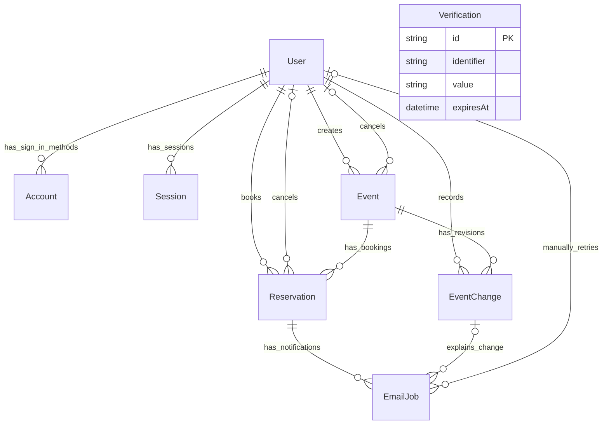

# Database Design

## 1. Purpose and Implementation Status

This document defines the V1 data model for [PRD.md](PRD.md) and [ARCHITECTURE.md](ARCHITECTURE.md): eight models supporting authentication, workshop management, individual reservations, significant-change history, and reliable booking/event notifications.

The current Prisma schema has no business models. This is the approved target design, not an applied schema or migration. Keep Prisma 7 and PostgreSQL. Review the generated authentication schema against the selected compatible Better Auth version before implementing it.

`prisma/schema.prisma` remains the source of truth for implemented models, relations, and supported constraints. Native SQL constraints described here must be included in reviewed Prisma migration files and noted alongside the affected models. After the planned backend folder move, the schema and migrations will live under `backend/prisma/`; until then, their existing root-level location remains current.

## 2. Conventions

- Better Auth identifiers and foreign keys pointing to them use its generated string identifier type; do not assume they are UUIDs.
- `Event`, `EventChange`, `Reservation`, and `EmailJob` use UUID primary keys, represented as Prisma `String` with `@db.Uuid` and generated on creation. Their foreign keys also use the PostgreSQL UUID type.
- Timestamps use Prisma `DateTime @db.Timestamptz(3)`, including the authentication timestamp fields when reviewing the generated schema. PostgreSQL stores these as instants; application input and display use `Asia/Jakarta` (WIB).
- Mutable models have `createdAt` and `updatedAt`. `EventChange` is immutable and has only `createdAt`.
- Required descriptive strings use PostgreSQL text and must be nonblank at the validation boundary. Optional fields are marked nullable below.
- Preserve Better Auth's generated model/table mappings. Application models use the Prisma names shown here, without additional table-name mappings; native SQL examples use those names.
- Normalize email using the selected Better Auth version's supported behavior and apply the same normalization to seed data. Public input and provider profile data cannot set `User.role`.
- Store the single organizer contact email in application configuration, not an organization/settings table or every event.

## 3. Entity Relationships



Optional actor relationships are populated only when their action occurs. `Verification` is intentionally independent: Better Auth looks up verification records by its identifier/token rules rather than a mandatory user foreign key.

## 4. Authentication Models

Follow Better Auth's core schema for `User`, `Account`, `Session`, and `Verification`. The field inventory below describes their responsibilities; retain any additional required fields, defaults, mappings, or indexes produced by the selected compatible version. Schema generation and migration are later implementation steps.

### User

| Field | Type / nullability | Purpose |
| --- | --- | --- |
| `id` | String, required primary key | Stable identity used by all business records. |
| `name` | Text, required | Attendee display name. |
| `email` | Text, required and unique | Login and communication address. |
| `emailVerified` | Boolean, required | Better Auth's verification state. |
| `image` | Text, nullable | Optional image URL supported by Better Auth. |
| `role` | `UserRole`, required, default `ATTENDEE` | Server-controlled application role. |
| `createdAt`, `updatedAt` | Timestamp, required | Creation and last update. |

`UserRole` values are `ATTENDEE` and `ADMIN`. Configure Better Auth's additional field consistently with these values and reject client/provider input for the role. Admins inherit attendee capabilities, but their own bookings use the same eligibility, capacity, and deadline checks.

One user can have email/password and Google sign-in methods. Both methods must resolve to the same user after eligible account linking; do not duplicate reservations or create a separate admin identity table.

### Account

| Field group | Type / nullability | Purpose |
| --- | --- | --- |
| `id` | String, required primary key | Local authentication-method record. |
| `userId` | String, required user foreign key | Owning identity. |
| `providerId`, `accountId` | Text, required | Provider and provider-side identity; enforce uniqueness of the pair. |
| `password` | Text, nullable | Better Auth-managed password hash for credential sign-in. |
| `accessToken`, `refreshToken`, `idToken`, `scope` | Text, nullable as supported by Better Auth | Provider data required by the selected integration. |
| `accessTokenExpiresAt`, `refreshTokenExpiresAt` | Timestamp, nullable | Provider token expiry where applicable. |
| `createdAt`, `updatedAt` | Timestamp, required | Creation and last update. |

Google-only users do not need a credential password. Better Auth owns password hashing, provider credentials, and linking; do not add a password column to `User` or implement a separate password store.

### Session

| Field | Type / nullability | Purpose |
| --- | --- | --- |
| `id` | String, required primary key | Session record. |
| `userId` | String, required user foreign key | Signed-in identity. |
| `token` | Text, required and unique | Better Auth session credential. |
| `expiresAt` | Timestamp, required | Session expiry. |
| `ipAddress`, `userAgent` | Text, nullable | Better Auth session metadata. |
| `createdAt`, `updatedAt` | Timestamp, required | Creation and refresh/update tracking. |

Better Auth validates and revokes sessions. Session tokens must not appear in business API responses, notification records, or application logs.

### Verification

| Field | Type / nullability | Purpose |
| --- | --- | --- |
| `id` | String, required primary key | Verification record. |
| `identifier`, `value` | Text, required | Better Auth-managed lookup and verification data. |
| `expiresAt` | Timestamp, required | Token validity boundary. |
| `createdAt`, `updatedAt` | Timestamp, required | Creation and update tracking. |

Retain Better Auth's required lookup indexes and token representation. Verification and password-reset emails are sent through Better Auth callbacks using the selected provider, with its resend/recovery flows; they are not stored in `EmailJob`.

## 5. Event

| Field | Type / nullability | Default / purpose |
| --- | --- | --- |
| `id` | UUID, required primary key | Generated on creation. |
| `createdById` | String, required user foreign key | Admin who created the workshop. |
| `title`, `description` | Text, required | Public workshop information. |
| `venueName`, `venueAddress` | Text, required | Physical location, stored on the event. |
| `startsAt`, `endsAt` | Timestamp, required | Workshop schedule. |
| `registrationClosesAt` | Timestamp, required | Admin-defined registration deadline. |
| `capacity` | Integer, required | Positive total number of places. |
| `status` | `EventStatus`, required | Default `DRAFT`. |
| `scheduleRevision` | Integer, required | Default `0`; increment on significant schedule/venue changes. |
| `cancelledAt` | Timestamp, nullable | Actual cancellation time; original schedule remains intact. |
| `cancelledById` | String, nullable user foreign key | Admin responsible for cancellation. |
| `cancellationReason` | Text, nullable | Required explanation when cancelled. |
| `createdAt`, `updatedAt` | Timestamp, required | Creation and last update. |

`EventStatus` values are `DRAFT`, `PUBLISHED`, and `CANCELLED`. V1 stores complete required event details when creating a draft; it does not introduce an incomplete-draft autosave model.

Fully booked, registration closed, started, and ended are calculated from status, schedule, deadline, and confirmed reservations. Do not persist these as additional event statuses or maintain a separate booked-place counter in V1.

### Event Rules

- `capacity > 0`, `endsAt > startsAt`, `registrationClosesAt <= startsAt`, and `scheduleRevision >= 0` are database checks.
- A cancelled event requires cancellation time, actor, and a nonblank reason. These fields are null for other statuses.
- Services enforce publication and time-dependent transition rules. Cancellation is available before `endsAt`, including after the session starts; at the scheduled end it closes.
- Significant changes to start/end times or venue are allowed only before the current `startsAt`. A revised start must still be in the future, and the revised deadline/schedule must satisfy the same validity rules.
- V1 does not introduce reopening a cancelled event. Cancelled event information and its affected reservations remain available as history.
- Capacity reductions must not fall below the confirmed count. This cross-record rule is checked under the event lock, not with a row-level `CHECK` expression.

## 6. EventChange

| Field | Type / nullability | Purpose |
| --- | --- | --- |
| `id` | UUID, required primary key | Immutable significant-change record. |
| `eventId` | UUID, required event foreign key | Changed workshop. |
| `revision` | Integer, required | New event revision, unique within the event. |
| `oldStartsAt`, `oldEndsAt` | Timestamp, required | Schedule immediately before the change. |
| `newStartsAt`, `newEndsAt` | Timestamp, required | Schedule immediately after the change. |
| `oldVenueName`, `oldVenueAddress` | Text, required | Previous location. |
| `newVenueName`, `newVenueAddress` | Text, required | New location. |
| `changedById` | String, required user foreign key | Admin who made the change. |
| `reason` | Text, required and nonblank | Explanation for the change and its notification. |
| `createdAt` | Timestamp, required | Time of the change. |

Each record stores the complete before/after schedule and venue, even when only one of those values changes. Both schedules must have end after start. `revision > 0` and unique `(eventId, revision)` are database-enforced.

On a significant change, increment `Event.scheduleRevision` and insert the matching `EventChange` in the same locked transaction. A combined date/venue edit creates one revision; an unchanged submission creates none. Description, capacity, and registration-deadline edits do not create schedule revisions.

Significant draft edits follow the same history/reason rule, although no notification jobs are needed without confirmed reservations. Revision `0` represents the initial event details and does not require a synthetic change row.

The service enforces consecutive revisions, valid actor permissions, and that the before/after values match the event mutation. Foreign keys and uniqueness alone do not establish those cross-record facts. This history supports notifications and cancellation eligibility; V1 does not add a separate history dashboard.

## 7. Reservation

| Field | Type / nullability | Default / purpose |
| --- | --- | --- |
| `id` | UUID, required primary key | One booking attempt. |
| `eventId` | UUID, required event foreign key | Reserved workshop. |
| `userId` | String, required user foreign key | Attendee, including an admin booking personally. |
| `bookingReference` | Text, required and unique | Opaque public reference, distinct from the internal identifier. |
| `status` | `ReservationStatus`, required | Default `CONFIRMED`. |
| `bookedRevision` | Integer, required | Event schedule revision at booking. |
| `cancelledAt` | Timestamp, nullable | Time the reservation was cancelled. |
| `cancelledById` | String, nullable user foreign key | Attendee/admin who performed the cancellation. |
| `cancellationSource` | `CancellationSource`, nullable | Self-service, admin action, or whole-event cancellation. |
| `cancellationReason` | Text, nullable | Required for admin/event cancellation; no new attendee reason form is required. |
| `createdAt`, `updatedAt` | Timestamp, required | Booking and last update. |

`ReservationStatus` values are `CONFIRMED` and `CANCELLED`. `CancellationSource` values are `SELF_SERVICE`, `ADMIN`, and `EVENT_CANCELLED`.

Generate booking references from cryptographically random data and enforce uniqueness in PostgreSQL. A collision must regenerate the reference and retry the rolled-back creation safely. A booking reference identifies a reservation; knowing it does not authorize access to another attendee's data.

### Cancellation and Rebooking History

- A confirmed reservation has all cancellation fields null.
- A cancelled reservation requires `cancelledAt`, `cancelledById`, and `cancellationSource`. `ADMIN` and `EVENT_CANCELLED` also require a nonblank reason.
- `bookedRevision >= 0` is a database check. The service copies the event's current revision while holding its lock and prevents later edits to that recorded revision.
- For self-service cancellation, `cancelledById` is the owning attendee. Admin cancellations record the actual admin and required reason, including when handling a late request.
- Whole-event cancellation changes all remaining confirmed reservations to cancelled, with source `EVENT_CANCELLED`, the cancelling admin, cancellation time, and event reason. Preserve reservations already cancelled earlier. Enqueue the corresponding event-cancellation messages in the same transaction.
- Rebooking creates a new row and reference with the current `bookedRevision`. Do not reset an old cancelled row to confirmed.

### One Confirmed Reservation per Attendee/Event

Add this native PostgreSQL partial unique index in a future reviewed migration:

```sql
CREATE UNIQUE INDEX reservation_one_confirmed_per_attendee
ON "Reservation" ("eventId", "userId")
WHERE "status" = 'CONFIRMED';
```

This permits multiple cancelled rows and at most one confirmed row per attendee/event. A unique constraint on all `(eventId, userId)` pairs would block rebooking; adding `status` to a normal unique constraint would wrongly limit cancelled history to one row.

Prisma 7's declarative partial-index support requires its `partialIndexes` preview feature. Keep the existing generator configuration and use the native migration index, documented with the model. Migration review and tests must preserve this index and other native checks.

### Event-change Exception

A confirmed reservation is affected when `bookedRevision < Event.scheduleRevision`. It may be self-cancelled before the revised start, overriding the ordinary more-than-24-hours cutoff. Otherwise the normal cutoff applies.

A later return to the original schedule still creates a revision and retains prior history; an earlier booking remains affected. New bookings and rebookings record the latest revision and do not inherit earlier cancellation exceptions.

## 8. EmailJob

Every queued business notification targets one reservation. Event-wide actions create one job per affected reservation, not a job containing a bulk list of recipients.

| Field | Type / nullability | Default / purpose |
| --- | --- | --- |
| `id` | UUID, required primary key | Stable delivery identity across retries. |
| `reservationId` | UUID, required reservation foreign key | Booking and recipient context. |
| `eventChangeId` | UUID, nullable change foreign key | Required only for an event-change notification. |
| `type` | `EmailJobType`, required | Notification being sent. |
| `recipientEmail` | Text, required | Recipient address captured when the job is created. |
| `deduplicationKey` | Text, required and unique | Identity of the logical notification, preventing duplicate job creation. |
| `status` | `EmailJobStatus`, required | Default `PENDING`. |
| `attemptCount` | Integer, required | Default `0`; total delivery attempts, retained across manual retries. |
| `retryCycleAttemptCount` | Integer, required | Default `0`; attempts in the current automatic/manual retry cycle. |
| `nextAttemptAt` | Timestamp, nullable | Required while pending; initial value is the enqueue time. |
| `lastAttemptAt` | Timestamp, nullable | Most recent provider-send attempt. |
| `claimToken` | UUID, nullable | Ownership token for the current processing claim. |
| `claimExpiresAt` | Timestamp, nullable | Lease boundary used to recover abandoned work. |
| `providerMessageId` | Text, nullable | Identifier returned by the selected provider. |
| `sentAt` | Timestamp, nullable | Provider-acceptance time, not inbox delivery. |
| `lastError` | Text, nullable | Latest sanitized delivery failure. |
| `skippedAt`, `skipReason` | Timestamp / text, nullable | Time and explanation for an obsolete notification. |
| `lastManualRetryById` | String, nullable user foreign key | Admin who last requested a manual retry. |
| `lastManualRetryAt` | Timestamp, nullable | Time of that request. |
| `createdAt`, `updatedAt` | Timestamp, required | Creation and current-state update. |

`EmailJobType` values are `BOOKING_CONFIRMED`, `RESERVATION_CANCELLED`, `EVENT_CANCELLED`, and `EVENT_CHANGED`.

`EmailJobStatus` values are `PENDING`, `PROCESSING`, `SENT`, `FAILED`, and `SKIPPED`.

### Message Context and Deduplication

Derive the logical deduplication key from notification type, reservation identifier, and the event-change identifier for change notices. Repeated cancellation requests or submission retries must not create another job for the same logical action. Rebooking has a new reservation identifier and therefore different notification keys.

Render from the linked reservation, event, and immutable change record. No generic JSON payload or stored authentication link is needed for the selected notification types. A still-valid confirmation uses current event details; change notices use their saved change/reason together with current information.

For an `EVENT_CHANGED` job, `eventChangeId` must be nonnull; it must be null for other types. This is a row-level check. The service additionally verifies that the change belongs to the reservation's event, since the individual foreign keys do not establish that relationship.

### State and Recovery Rules

| State | Required state-specific data / behavior |
| --- | --- |
| `PENDING` | `nextAttemptAt` is set; no active claim, sent time, or skip metadata. |
| `PROCESSING` | Claim token and expiry are set; `nextAttemptAt` is cleared. |
| `SENT` | `sentAt` is set; no claim, retry time, or skip metadata. |
| `FAILED` | A nonblank `lastError` is set; no claim, retry time, sent time, or skip metadata. |
| `SKIPPED` | `skippedAt` and a nonblank `skipReason` are set; no claim, retry time, or sent time. |

Implement state/metadata consistency with native database checks. Counters must be nonnegative and `retryCycleAttemptCount <= attemptCount`. Manual-retry actor and timestamp must be either both populated or both null. `lastError` may remain as diagnostic history after a later successful retry; it does not determine current status.

Processing claims eligible work atomically in a short transaction, with row locks and `SKIP LOCKED`, then releases that transaction before contacting the provider. Results and ownership changes must condition on the current claim token. A stale worker cannot overwrite a newer claim's result. Count a delivery attempt immediately before invoking the provider, not when merely checking whether a message is obsolete.

Recover expired claims into eligible processing/retry state, respecting the retry-cycle limit. If an interrupted attempt used the final permitted attempt, record a failure rather than leaving the job permanently processing. Use the job's stable identifier as the provider idempotency identity where supported. An ambiguous timeout can still cause duplicate email; neither claims nor deduplication guarantee exactly-once delivery.

Manual retry applies to `FAILED` jobs: keep the same job/deduplication identity and total attempts, reset the retry-cycle count, set pending time, and record the admin/time. Automatic and manual paths share the same claim and obsolescence checks; neither repeats the booking or event operation.

The model stores an attempt count and latest error, not a separate row for every delivery attempt. Exact retry counts, delays, claim duration, provider timeouts, and provider-specific idempotency behavior must be decided before sender implementation, without adding those operational settings as database entities.

### Obsolete Notifications

Before provider invocation:

- Skip a booking confirmation if its reservation or event has been cancelled.
- Skip an event-change notice if a later schedule revision supersedes it, the event has been cancelled, or that reservation is no longer confirmed.
- Retain a cancellation notice for its specific cancelled booking even if the attendee later creates another reservation.
- Record `SKIPPED`, time, and a useful reason. Skipped jobs are diagnostic records, not failures offered for manual retry.

Do not mark an in-flight email as recallable. State may change after eligibility was checked; subsequent notifications and current website details communicate those changes. All obsolete reservations, changes, and job records remain in history.

## 9. Transaction and Constraint Responsibilities

### PostgreSQL Enforces

- Required fields, foreign keys, enum values, and unique identifiers.
- Unique authentication provider identity, booking reference, event revision, and notification deduplication key.
- The partial uniqueness rule for confirmed reservations.
- Positive capacity, valid start/end ordering, registration deadline no later than start, and nonnegative revisions/counters.
- Nonblank required reasons and consistent nullable cancellation/delivery metadata. Native checks must test nullability explicitly as well as string content.

### Services Enforce

- Authentication, current role, verified-email eligibility, and reservation ownership.
- Publication transitions, before-start schedule/venue changes, before-end event cancellation, and attendee cancellation windows.
- Sequential schedule revisions and coherent event/change/notification relationships.
- Current confirmed count within capacity and an eligible registration deadline at booking time.
- Valid retry transitions, ownership fencing, obsolescence, and safe public error messages.

Each relevant mutation takes the event row lock in a Prisma 7 interactive transaction at `READ COMMITTED`, checks current state after the lock, and commits business changes with their email jobs. A failure rolls back both. Rebooking is a new insert under the same rule; concurrent creation is also protected by the partial unique index.

When a transaction waits for a lock, use the current wall-clock instant after acquisition for deadline decisions. PostgreSQL `CURRENT_TIMESTAMP`/`now()` represent transaction start, so they must not be mistaken for the time after waiting. The implementation can obtain a fresh application instant or PostgreSQL `clock_timestamp()` after the lock.

The cross-row confirmed-count limit cannot be expressed as an ordinary event `CHECK` that queries reservations. Do not replace the agreed locking protocol with a nontransactional read-then-insert sequence. Provider HTTP calls remain outside database transactions.

## 10. Indexes and Deletion Rules

### Query-driven Indexes

| Model | Index / constraint | Supports |
| --- | --- | --- |
| Authentication models | Better Auth-generated keys and indexes, including unique `(providerId, accountId)` | Login, session lookup, verification, and linked identities. |
| `Event` | `(status, startsAt)` | Published upcoming-event discovery. |
| `EventChange` | Unique `(eventId, revision)` | Revision integrity and chronological change lookup. |
| `Reservation` | Unique `bookingReference` | Booking-reference lookup. |
| `Reservation` | Partial unique `(eventId, userId)` where confirmed | At most one active booking per attendee/event. |
| `Reservation` | `(userId, createdAt)` | My reservations and history. |
| `Reservation` | `(eventId, status)` | Attendee lists and confirmed counts. |
| `EmailJob` | Unique `deduplicationKey` | One job per logical notification. |
| `EmailJob` | `(status, nextAttemptAt)` | Pending delivery selection. |
| `EmailJob` | `(status, claimExpiresAt)` | Abandoned-claim recovery. |
| `EmailJob` | `reservationId` | Reservation-linked delivery diagnosis. |

Title search can use the selected case-insensitive query behavior for the demo. Add specialized search indexes only if an actual query need justifies them; the proposed design does not require a search extension.

### Deletion and Retention

Use restrictive deletion for `Event`, `EventChange`, `Reservation`, and `EmailJob` business relationships and for their user/actor references. Parent deletion must not silently erase booking, cancellation, change, or delivery history. Do not apply cascade deletion from a user or event into these business records.

Preserve Better Auth's normal session/account cleanup relationships, including its generated user-deletion behavior for auth-owned dependents. Existing business references still block deleting a referenced user. V1 has no user-deletion feature or business-history purge.

Expiry and library-managed cleanup of auth sessions/verification records are distinct from business-history retention. V1 does not add general soft-delete fields or an automatic retention infrastructure.

## 11. Implementation Boundaries and Verification

The schema will be implemented later with Prisma models plus reviewed native SQL migrations for the documented checks and partial unique index. Keep native constraints visible in schema comments and migration review; do not enable a preview feature or change dependencies implicitly. A clean database rebuilt from migrations must retain these constraints.

`TASKS.md` will order the implementation and turn these scenarios into focused checks:

| Scenario | Expected result |
| --- | --- |
| Competing requests for the last place | One confirmed reservation; no overbooking. |
| Concurrent duplicate bookings | At most one confirmed row for the same attendee/event. |
| Cancel, rebook, cancel again | Distinct references and retained cancelled rows; a later eligible rebooking remains possible. |
| Capacity reduction versus booking | The locked operations cannot commit a capacity below confirmed reservations. |
| Significant changes and later rebooking | Earlier bookings receive the cancellation exception; new bookings record the latest revision. |
| Schedule/venue change at or after start | Rejected without mutating history or creating jobs. |
| Event cancellation during the session | Original schedule retained; remaining confirmed bookings cancelled with actor/reason and jobs. |
| Event cancellation at or after scheduled end | Rejected. |
| Invalid cancellation or delivery metadata | Native checks reject inconsistent rows, including null required reasons. |
| Transaction rollback | Neither a partial business change nor its notification jobs survive. |
| Interrupted processing or expired claim | Work recovers or fails according to the limit; stale claim owners cannot overwrite newer results. |
| Manual retry competing with a worker | One current claim; counters/history retained; no repeated business mutation. |
| Superseded notification | Job becomes skipped with a reason; valid cancellation notices remain tied to their original reference. |
| Incorrect change/event pairing | Service rejects a job whose change belongs to another event. |
| Timestamp and cutoff boundaries | UTC instants are compared consistently and displayed/interpreted in WIB. |
| Referenced parent deletion | Business-history foreign keys prevent cascading loss. |

Use PostgreSQL integration tests for transactional/index behavior. This documentation change does not create tests, connect to a database, edit `schema.prisma`, or run migrations.

Remaining implementation decisions are the compatible Better Auth package version/generated-schema review, email provider, numeric delivery settings, provider idempotency behavior, and actual Railway plans/spending limit. The eight-model design and product rules above are resolved.

## 12. References

- [Better Auth core database schema](https://better-auth.com/docs/concepts/database#core-schema) and [Prisma adapter](https://better-auth.com/docs/adapters/prisma) — authentication models and schema-generation boundary.
- [Better Auth account linking](https://better-auth.com/docs/concepts/users-accounts#account-linking) — connecting sign-in methods to one user.
- [PostgreSQL partial unique indexes](https://www.postgresql.org/docs/current/indexes-partial.html) — uniqueness restricted to confirmed reservations.
- [Prisma 7 partial-index configuration](https://www.prisma.io/docs/orm/v7/prisma-schema/data-model/indexes#configuring-partial-indexes-with-where) — preview-feature trade-off behind the native migration decision.
- [PostgreSQL constraints](https://www.postgresql.org/docs/current/ddl-constraints.html) — row checks, foreign keys, and limitations of cross-row checks.
- [PostgreSQL row locking](https://www.postgresql.org/docs/current/explicit-locking.html#LOCKING-ROWS) — coordinating booking and event mutations.
- [PostgreSQL date/time types](https://www.postgresql.org/docs/current/datatype-datetime.html) — timezone-aware storage and transaction-time semantics.
